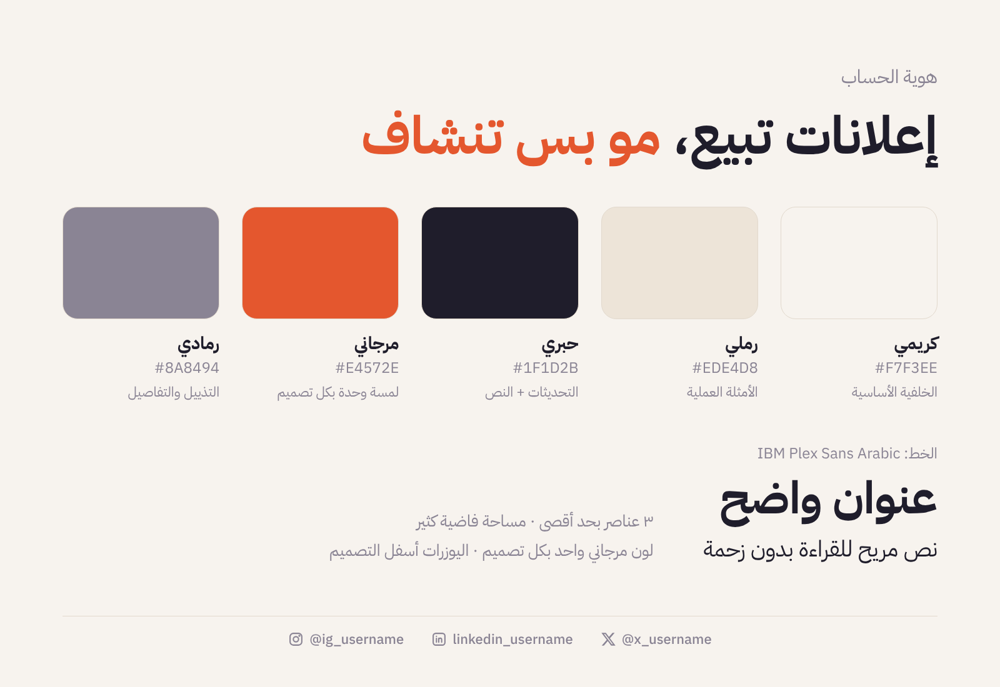

# هوية الانستجرام — إدارة الحملات الإعلانية

**الفكرة:** «إعلانات تبيع، مو بس تنشاف». هوية هادية وواثقة: مختصة تتكلم بأرقام وأمثلة، مو بشعارات.

## البايو (اختاري واحد)
1. إدارة حملات إعلانية | ميتا · قوقل · تيك توك · سناب
   أحوّل ميزانيتك لمبيعات، مو لايكات 📊
   ⬇️ لمراجعة حسابك الإعلاني
2. مختصة إعلانات ممولة 🇸🇦
   محتوى يومي: تحديثات المنصات + أخطاء تحرق الميزانية + أمثلة عملية
3. أبني حملات تبيع على كل المنصات
   للمتاجر والمشاريع السعودية | الخاص للاستشارات

**الاسم الظاهر في البروفايل:** «رنيم | إدارة حملات إعلانية» (كلمة «إعلانات» في الاسم تساعد البحث داخل انستجرام).

## الألوان والخط
| اللون | Hex | الاستخدام |
|---|---|---|
| كريمي | `#F7F3EE` | الخلفية الأساسية (نصايح، مشاكل، شخصي) |
| رملي | `#EDE4D8` | الأمثلة العملية |
| حبري | `#1F1D2B` | النص + خلفية التحديثات |
| مرجاني | `#E4572E` | لمسة وحدة بس بكل تصميم |
| رمادي | `#8A8494` | التذييل والتفاصيل |

الخط: **IBM Plex Sans Arabic** — عريض للعناوين، عادي للنص.

## قواعد التصميم
- ٣ عناصر بحد أقصى بالشريحة: شارة صغيرة، عنوان، سطرين شرح.
- مساحة فاضية كثير. ما فيه صور خلفية ولا زخارف.
- أسفل كل تصميم: خط رفيع + أيقونات انستجرام/لينكدإن/X صغيرة + اليوزرات فقط (بدون روابط).
- الكاروسيل: غلاف ← شرائح مرقّمة (الرقم بالمرجاني) ← شريحة حفظ/تفاعل.

## إيقاع الشبكة (Grid)
التحديثات بخلفية داكنة، الأمثلة رملية، والباقي كريمي. كذا الشبكة تطلع متناسقة ومتنوعة بنفس الوقت بدون ما تخطط كل مربع.

## الهايلايت
أغطية جاهزة في `designs/brand/highlight-*.png`: تحديثات · نصايح · أمثلة · خدماتي · آراء.

## مواعيد النشر (بتوقيت السعودية)
| المنصة | الوقت | ليش |
|---|---|---|
| لينكدإن | ٩:١٥ ص | بداية الدوام |
| X | ١:٣٠ م | استراحة الظهر |
| انستجرام | ٨:٤٥ م | ذروة الاستخدام المسائي |
