# خطة المحتوى — ٢٠ يوم (١٢–٣١ أكتوبر ٢٠٢٦)

كل يوم = بوست انستجرام (كاروسيل) + بوست لينكدإن + تغريدة/ثريد في X، وكل منصة بصيغتها. التصاميم في `designs/day-XX/`.

| اليوم | التاريخ | النوع | الموضوع | انستجرام | لينكدإن | X |
|---|---|---|---|---|---|---|
| 1 | 2026-10-12 | شخصي | تعريف: ليش أغلب الإعلانات تحرق فلوس | كاروسيل 5 شرائح | نص + صورة | تغريدة + صورة |
| 2 | 2026-10-13 | تحديث | ميتا Andromeda: الكرييتف صار هو الاستهداف | كاروسيل 5 شرائح | نص + صورة | ثريد 4 + صورة |
| 3 | 2026-10-14 | مشكلة | زر الترويج (Boost) مو حملة إعلانية | كاروسيل 5 شرائح | نص + صورة | تغريدة + صورة |
| 4 | 2026-10-15 | نصيحة | أرقام الحملة بالسعودي: CPM، CTR، CPA، ROAS | كاروسيل 6 شرائح | نص + صورة | ثريد 3 + صورة |
| 5 | 2026-10-16 | تحديث | قوقل AI Max for Search: الكلمات المفتاحية لحالها ما تكفي | كاروسيل 5 شرائح | نص + صورة | تغريدة + صورة |
| 6 | 2026-10-17 | مثال | مثال: دمج الحملات وتنويع الكرييتف لمتجر عبايات | كاروسيل 5 شرائح | نص + صورة | تغريدة + صورة |
| 7 | 2026-10-18 | نصيحة | سناب شات في السعودية: لا تتجاهله | كاروسيل 5 شرائح | نص + صورة | تغريدة + صورة |
| 8 | 2026-10-19 | تحديث | تيك توك Smart+: تحكم أكثر في الأتمتة | كاروسيل 5 شرائح | نص + صورة | تغريدة + صورة |
| 9 | 2026-10-20 | مشكلة | البكسل لحاله ما يكفي: Conversions API | كاروسيل 5 شرائح | نص + صورة | ثريد 3 + صورة |
| 10 | 2026-10-21 | مشكلة | نظام حماية البيانات الشخصية (PDPL) والتسويق | كاروسيل 5 شرائح | نص + صورة | تغريدة + صورة |
| 11 | 2026-10-22 | نصيحة | صفحة الهبوط: الإعلان يجيب الزيارة، الصفحة تبيع | كاروسيل 6 شرائح | نص + صورة | تغريدة + صورة |
| 12 | 2026-10-23 | نصيحة | الوايت فرايدي: ابدأ تحضيرك الحين | كاروسيل 6 شرائح | نص + صورة | تغريدة + صورة |
| 13 | 2026-10-24 | مشكلة | مرحلة التعلّم: لا تلمس الحملة كل يوم | كاروسيل 5 شرائح | نص + صورة | تغريدة + صورة |
| 14 | 2026-10-25 | نصيحة | الريتارقتنق بدون إزعاج | كاروسيل 6 شرائح | نص + صورة | تغريدة + صورة |
| 15 | 2026-10-26 | مشكلة | إرهاق الإعلان: متى تغيّر الكرييتف | كاروسيل 6 شرائح | نص + صورة | تغريدة + صورة |
| 16 | 2026-10-27 | تحديث | تغييرات الإسناد والتقارير: لا تقارن أرقام قديمة بجديدة | كاروسيل 5 شرائح | نص + صورة | تغريدة + صورة |
| 17 | 2026-10-28 | مثال | صناع المحتوى (UGC) مقابل المشاهير | كاروسيل 5 شرائح | نص + صورة | تغريدة + صورة |
| 18 | 2026-10-29 | شخصي | كواليس: أول أسبوع مع أي حساب إعلاني | كاروسيل 6 شرائح | نص + صورة | ثريد 3 + صورة |
| 19 | 2026-10-30 | مشكلة | خرافات شائعة عن الإعلانات الممولة | كاروسيل 5 شرائح | نص + صورة | تغريدة + صورة |
| 20 | 2026-10-31 | دعوة | خلاصة ٢٠ يوم + دعوة للتواصل | كاروسيل 6 شرائح | نص + صورة | ثريد 4 + صورة |

---

## اليوم 1 — تعريف: ليش أغلب الإعلانات تحرق فلوس
**2026-10-12 · شخصي**

### انستجرام
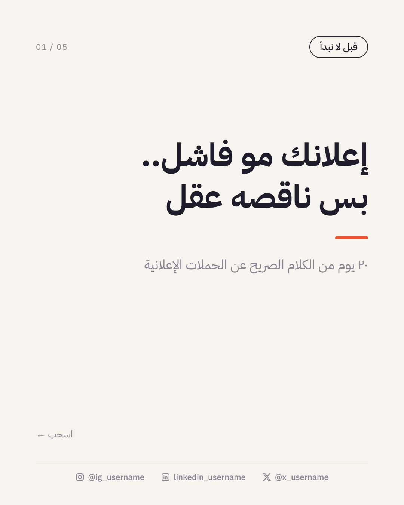

صراحة؟ أغلب الحسابات اللي تجيني ما عندها مشكلة ميزانية.. عندها مشكلة توزيع.

فلوس تروح على جمهور غلط، أو إعلان مكرر من شهرين، أو صفحة هبوط تطفّش العميل قبل لا يشتري.

قررت أبدأ ٢٠ يوم محتوى يومي، أشارك فيه اللي أتعلمه من إدارة الحملات: تحديثات ميتا وقوقل وتيك توك وسناب، المشاكل اللي تتكرر، وكيف نحلها.

إذا عندك سؤال عن حملاتك اكتبه بالتعليقات، يمكن يصير بوست الأسبوع الجاي 👇

#تسويق_رقمي #اعلانات_ممولة #ميتا_ادز #اعلانات_سناب #السعودية #ريادة_اعمال

### لينكدإن
أغلب الحسابات الإعلانية اللي أراجعها ما تعاني من قلة ميزانية.

تعاني من توزيع غلط.

حملات كثيرة كل وحدة فيها مبلغ بسيط، ما توصل لمرحلة التعلّم.
إعلانات نفسها من شهور.
وتقارير مليانة أرقام حلوة.. بس المبيعات ما تحركت.

خلال الـ٢٠ يوم الجاية بشارك هنا بشكل يومي:
– تحديثات المنصات الإعلانية وأثرها الفعلي على السوق السعودي
– أخطاء تتكرر في الحملات وكيف تنحل
– أمثلة عملية من شغل إدارة الحملات

سؤالي لك: وش أكثر شي يضايقك في نتائج إعلاناتك الحين؟

#التسويق_الرقمي #الإعلانات_الممولة #السعودية

### X
أغلب الحسابات الإعلانية اللي أراجعها ما تحتاج ميزانية أكبر..
تحتاج أحد يوقف النزيف أول 🩹

من بكرة بنزل يوميًا شي عملي عن الحملات (ميتا، قوقل، تيك توك، سناب). تابعوا وخلّوا أسئلتكم هنا 👇

## اليوم 2 — ميتا Andromeda: الكرييتف صار هو الاستهداف
**2026-10-13 · تحديث**

### انستجرام
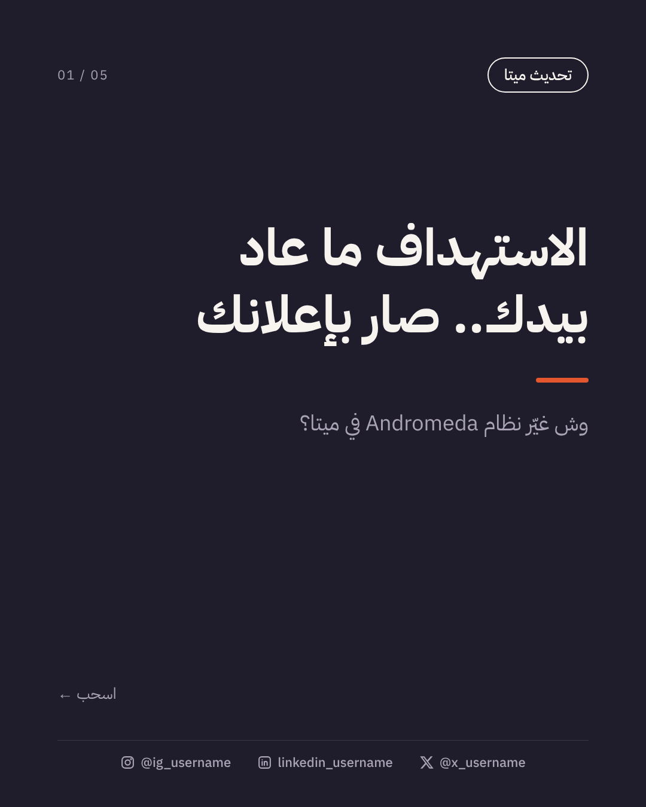

كنا زمان نقضي ساعة نختار اهتمامات: "مهتمين بالأزياء + السفر + عمر ٢٥-٣٤"..

الحين ميتا تقول لك ببساطة: خلّ هذا الشغل علي، وانت ركّز على الإعلان.

نظام Andromeda يقرأ الإعلان نفسه (الصورة، الكلام، أول ثانيتين بالفيديو) ويقرر مين يوصله. عشان كذا الحملات اللي فيها إعلان واحد بس صارت تتعب بسرعة.

نصيحتي: بدل ٦ مجموعات إعلانية كل وحدة فيها إعلانين، جرّب مجموعة أو ثنتين فيها ٨-١٠ إعلانات مختلفة فعلًا.

جربتها؟ قول لي بالتعليقات وش لاحظت.

#ميتا_ادز #اعلانات_انستقرام #اعلانات_فيسبوك #تسويق_رقمي #كرييتف #السعودية

### لينكدإن
واحد من أهم التغييرات في ميتا خلال السنة الأخيرة ما كان زر جديد.. كان طريقة التفكير.

نظام Andromeda صار يختار الإعلانات اللي تدخل المزاد ومين يشوفها بناءً على محتوى الإعلان نفسه أكثر من إعدادات الاستهداف.

الأثر اللي أشوفه عمليًا:
• الحسابات اللي تعتمد على إعلان أو اثنين تتشبع بسرعة
• تقسيم الميزانية على مجموعات كثيرة صار يضعف التعلّم
• فريق التصميم صار جزء من فريق الأداء، مو قسم منفصل

السؤال اللي صار لازم ينسأل في كل اجتماع: كم زاوية رسالة مختلفة عندنا هالشهر؟ مو كم اهتمام أضفنا.

هل غيّرتوا طريقة بناء الحملات عندكم بعد هالتحديث؟

#MetaAds #الإعلانات_الممولة #التسويق_بالأداء

### X
**1/4** اللي للحين يقضي ساعة يختار اهتمامات في ميتا..
النظام صار يختار الجمهور من الإعلان نفسه (Andromeda). 🧵

**2/4** يعني إعلان واحد مكرر = جمهور واحد يتعب بسرعة.
١٠ إعلانات مختلفة فعلًا (زاوية، شخص، رسالة) = فرص أكثر يلقى فيها النظام مشترين.

**3/4** اللي أطبقه الحين:
– مجموعة أو ثنتين بدل ست
– ٨-١٠ إعلانات متنوعة
– أراقب أول ٣ ثواني بالفيديو أكثر من الـ CTR

**4/4** مو معناه الاستهداف مات تمامًا، الريتارقتنق للحين له مكانه. بس الشغل الحقيقي انتقل للكرييتف.

## اليوم 3 — زر الترويج (Boost) مو حملة إعلانية
**2026-10-14 · مشكلة**

### انستجرام
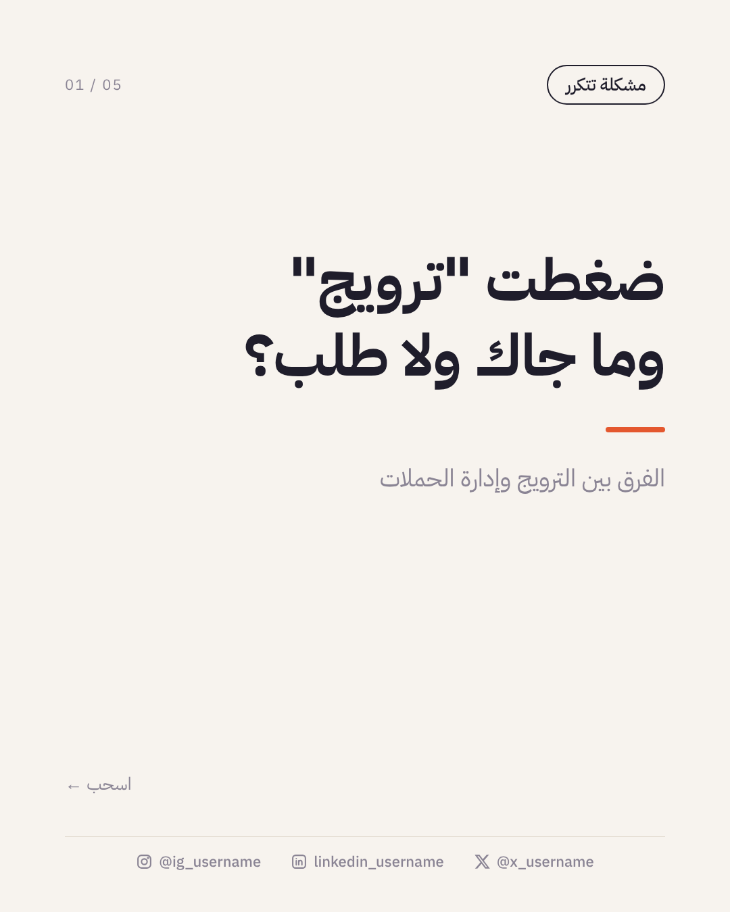

هذي أكثر رسالة توصلني: "روجت البوست بـ٥٠٠ ريال وجاني ٣٠٠٠ لايك وما بعت شي"

طبيعي! لأنك قلت للمنصة جيب لي تفاعل.. وهي جابته 🙂

الترويج مو غلط، بس هدفه مختلف. لو تبي مبيعات أو رسائل واتساب، روح لمدير الإعلانات واختر الهدف الصح، وركّب البكسل أو تتبع المحادثات.

فرق بسيط بالإعداد، بس يفرق بالنتيجة كثير.

#اعلانات_ممولة #ترويج #مدير_الاعلانات #متاجر_الكترونية #مشاريع_صغيرة #السعودية

### لينكدإن
"صرفنا على الترويج ورجع لنا تفاعل ممتاز.. بس المبيعات ثابتة"

أسمع هالجملة كثير من أصحاب المشاريع، والسبب غالبًا بسيط: الهدف اللي اخترته هو اللي يحدد نوع الناس اللي توصلهم.

زر الترويج مصمم أساسًا للتفاعل والوصول. والخوارزمية شاطرة جدًا، تجيب لك بالضبط الناس اللي يتفاعلون.. ونفس هالناس نادرًا يشترون.

إذا كان الهدف مبيعات أو عملاء محتملين:
١. ابدأ من مدير الإعلانات مو من البوست
٢. اختر هدف مرتبط بالنتيجة الفعلية
٣. تأكد إن التتبع شغال قبل ما تصرف ريال واحد

الترويج له مكانه، بس ما يغني عن حملة مبنية صح.

#التسويق_الرقمي #ريادة_الأعمال #MetaAds

### X
"روّجت البوست وجاني آلاف اللايكات وما بعت شي"

لأن زر الترويج غالبًا يدور لك ناس تتفاعل، مو ناس تشتري.
تبي مبيعات؟ مدير الإعلانات + هدف مبيعات + بكسل شغال. فرق ٥ دقايق إعداد.

## اليوم 4 — أرقام الحملة بالسعودي: CPM، CTR، CPA، ROAS
**2026-10-15 · نصيحة**

### انستجرام
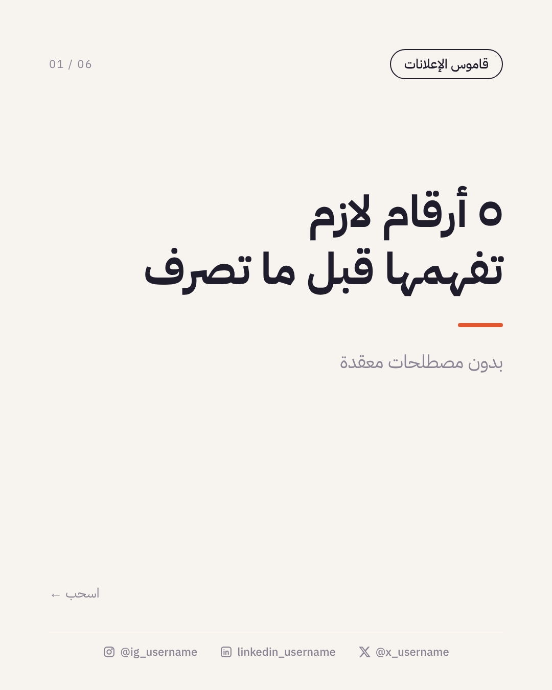

مرّة جلست مع صاحبة متجر وقالت لي: "الوكالة ترسل لي تقرير ١٢ صفحة وأنا ما أفهم ولا رقم" 😶

وهذا حقك تفهم! فكتبت لك أهم الأرقام بشكل مبسط.

لو بتمسك رقم واحد بس: امسك تكلفة الطلب (CPA) وقارنها بربحك من الطلب. الباقي أرقام تساعدك تعرف وين الخلل.

والرقم الخامس؟ الـ Frequency، كم مرة نفس الشخص شاف إعلانك. نتكلم عنه بالتفصيل الأسبوع الجاي.

#اعلانات_ممولة #تحليل_البيانات #تسويق_رقمي #متجر_الكتروني #رواد_الاعمال #السعودية

### لينكدإن
تقرير الحملة فيه ROAS = 4 والكل مبسوط.

بس لو هامش الربح ٢٠٪ وتكاليف الشحن والإرجاع عالية، ممكن يكون المشروع خسران بهدوء.

الأرقام اللي أحرص أصحاب المشاريع يفهمونها:
• CPM: تكلفة الوصول، وتتأثر بالموسم والمنافسة
• CTR: مؤشر على قوة الإعلان
• CPA: تكلفة الطلب الفعلي
• ROAS: العائد على الإنفاق الإعلاني
• Break-even ROAS: أقل عائد تحتاجه عشان ما تخسر

الأخير هو اللي يغيب كثير، مع إنه أهم واحد. احسبه مرة وحدة وخله مرجعك لكل حملة.

أنت تعرف رقم التعادل لمشروعك؟

#التسويق_بالأداء #التجارة_الإلكترونية #ROAS

### X
**1/3** ROAS عالي ≠ ربح 🧵

لو تبيع منتج بـ١٠٠ وتكلفته ٦٠ وشحنه ١٥، يبقى لك ٢٥ ريال قبل الإعلان.

**2/3** يعني لازم إعلانك يجيب الطلب بأقل من ٢٥ ريال عشان ما تخسر.
هذا رقم التعادل (Break-even). بالمثال هذا = ROAS 4 تقريبًا.

**3/3** فلو الوكالة جايبة لك ROAS 3 ومبسوطة.. انت تخسر على كل طلب.
احسب رقمك قبل ما تحكم على أي حملة.

## اليوم 5 — قوقل AI Max for Search: الكلمات المفتاحية لحالها ما تكفي
**2026-10-16 · تحديث**

### انستجرام
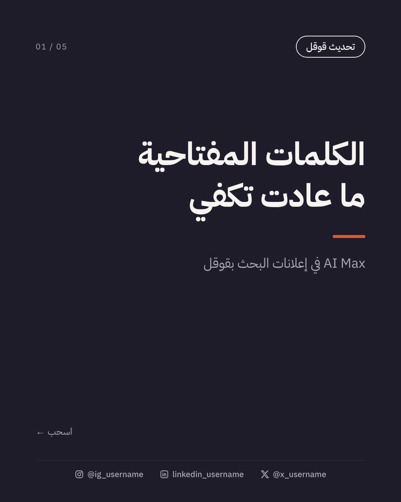

الناس ما تبحث زي ما نكتب الكلمات المفتاحية 😄

واحد يكتب "عبايه سوداء ساده للدوام" وثاني يكتب "عبايات عمليه".. وثالث يكتبها بالإنجليزي.

قوقل طلعت AI Max لحملات البحث عشان تلحق هالتنوع. يوسّع الكلمات، ويغير نص الإعلان والصفحة اللي يودي لها.

أنا أشوفه مفيد، بس بشرط: تقرير عبارات البحث يصير صديقك اليومي أول أسبوعين، والكلمات السلبية جاهزة.

مستخدمه أو للحين متردد؟

#قوقل_ادز #اعلانات_قوقل #GoogleAds #تسويق_رقمي #SEM #السعودية

### لينكدإن
قوقل تتجه بوضوح لإعلانات بحث أقل اعتمادًا على الكلمات المفتاحية الدقيقة، و AI Max for Search من أوضح الأمثلة.

الفكرة: النظام يوسّع عمليات البحث اللي يظهر لها الإعلان، ويخصص النص والرابط بناءً على نية الباحث.

في السوق السعودي هذا مهم لأن البحث يجي بالعربي الفصيح والعامي والإنجليزي، وكثير منه بأخطاء إملائية.

لكن عندي ثلاث قواعد قبل تفعيله:
١. تحويلات دقيقة ومربوطة صح
٢. قائمة كلمات سلبية جاهزة من البداية
٣. مراجعة عبارات البحث بشكل يومي أول أسبوعين

الأتمتة تكبّر اللي عندك. لو التتبع ضعيف، بتكبّر الخطأ.

#GoogleAds #التسويق_الرقمي #AI

### X
فعّلت AI Max في حملات البحث بقوقل؟
أهم شي أول أسبوعين: افتح تقرير عبارات البحث كل يوم وضيف الكلمات السلبية.

التوسّع يجيب فرص حلوة.. ويجيب معها بحث مالك فيه أي علاقة 😅

## اليوم 6 — مثال: دمج الحملات وتنويع الكرييتف لمتجر عبايات
**2026-10-17 · مثال**

### انستجرام
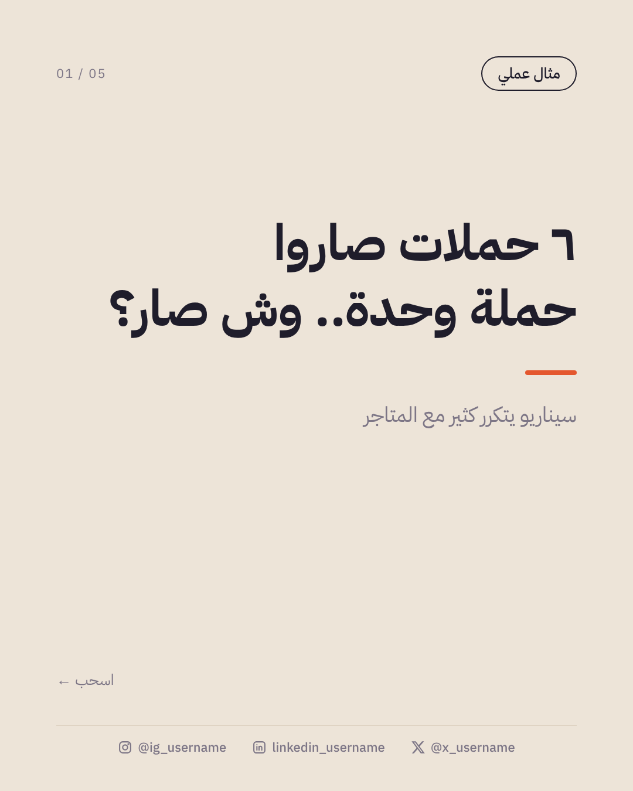

هذا من أكثر السيناريوهات اللي أشوفها مع المتاجر الصغيرة والمتوسطة.

النية طيبة: "نختبر جماهير كثيرة". بس النتيجة إن الميزانية تتفتت، وكل مجموعة تاخذ ٣٠-٥٠ ريال باليوم وما تكمل تعلّمها.

الحل غالبًا عكس المتوقع: قلل الحملات، وزوّد الإعلانات.

والأهم: لا تحكم بعد يومين. الخوارزمية تحتاج وقت ونتائج كافية عشان تستقر.

(مثال توضيحي مبني على حالات متكررة، كل حساب له ظروفه 🤍)

#ميتا_ادز #متاجر_الكترونية #عبايات #اعلانات_ممولة #تسويق_رقمي #السعودية

### لينكدإن
سيناريو أشوفه كثير عند المتاجر الإلكترونية:

٦ مجموعات إعلانية، كل وحدة بميزانية صغيرة، ونفس الإعلانات مكررة فيها كلها.

النتيجة؟ ولا مجموعة تجمع بيانات كافية تطلعها من مرحلة التعلّم، والتكلفة تتذبذب كل يوم.

التعديل اللي غالبًا أبدأ فيه:
• دمج المجموعات في مجموعة أو اثنتين
• رفع عدد الإعلانات المتنوعة فعليًا
• تثبيت الإعدادات ٧ أيام على الأقل قبل الحكم

الدرس الأكبر بالنسبة لي: الإدارة الجيدة للحملات اليوم أقرب لإدارة الأفكار الإعلانية منها لإدارة الإعدادات.

وش أكبر عدد مجموعات إعلانية شفته في حملة وحدة؟ 😄

#التجارة_الإلكترونية #MetaAds #التسويق_بالأداء

### X
٦ مجموعات إعلانية × ٤٠ ريال باليوم = ولا وحدة تتعلم.
مجموعتين × ١٢٠ ريال + ١٠ إعلانات متنوعة = بيانات كافية والنظام يشتغل.

نفس الميزانية، نتيجة مختلفة. لا تفتت فلوسك.

## اليوم 7 — سناب شات في السعودية: لا تتجاهله
**2026-10-18 · نصيحة**

### انستجرام
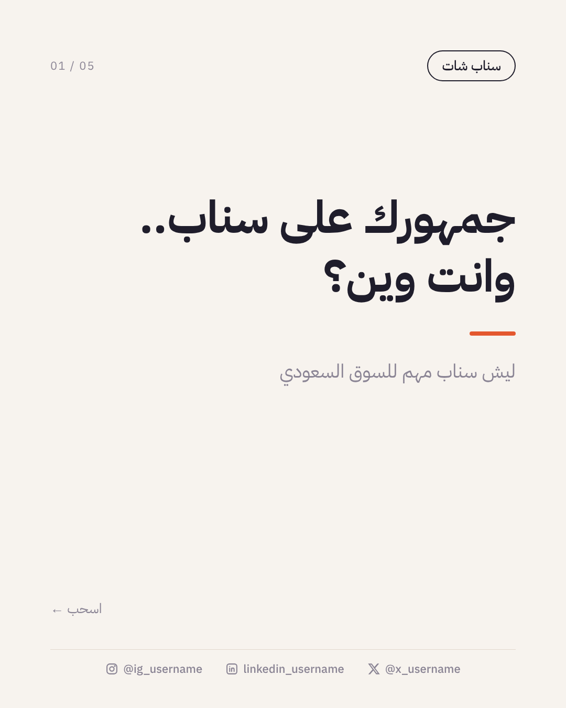

أحيانًا أسأل العميل: "وين جمهورك يقضي وقته؟" يقول انستقرام.
وبعدين نشوف الأرقام.. ونلقى سناب يجيب نتائج أحسن بتكلفة أقل 👀

مو قاعدة ثابتة، يعتمد على المنتج والفئة. بس تجاهل سناب في السوق السعودي غلط كبير، خصوصًا للمطاعم والكافيهات والعطور والمنتجات اللي تنباع بالعاطفة والسرعة.

السر؟ إعلانك لازم يحسس الشخص إنه سناب طبيعي، مو إعلان.

#اعلانات_سناب #سناب_شات #تسويق_رقمي #مطاعم_الرياض #عطور #السعودية

### لينكدإن
في كثير من الخطط الإعلانية اللي أشوفها، سناب شات ياخذ آخر ٥٪ من الميزانية "للتجربة".

مع إن السعودية من أكبر وأنشط أسواق سناب عالميًا، والاستخدام اليومي فيه عالي جدًا عند فئات كثيرة.

ملاحظاتي من الحملات:
• الإعلانات اللي تشبه محتوى المستخدم العادي تتفوق على الإعلانات المصقولة
• الرسالة لازم تكون في أول ثانيتين
• القطاعات السريعة (أكل، عطور، عروض محدودة) تستفيد منه بشكل واضح

ما أقول حط كل الميزانية فيه. أقول اختبره بميزانية تكفي يتعلّم، وبكرييتف مصنوع له، مو منقول من منصة ثانية.

كيف تجربتكم مع سناب مقارنة بميتا؟

#SnapchatAds #السوق_السعودي #التسويق_الرقمي

### X
أكثر غلط أشوفه في إعلانات سناب: ناخذ نفس فيديو انستقرام ونرفعه.

سناب يبي شي يحسسك إن صديقك مصوره: عمودي، سريع، الرسالة بأول ثانيتين، وبدون مونتاج تلفزيوني.

وفي السوق السعودي؟ تجاهله خسارة.

## اليوم 8 — تيك توك Smart+: تحكم أكثر في الأتمتة
**2026-10-19 · تحديث**

### انستجرام
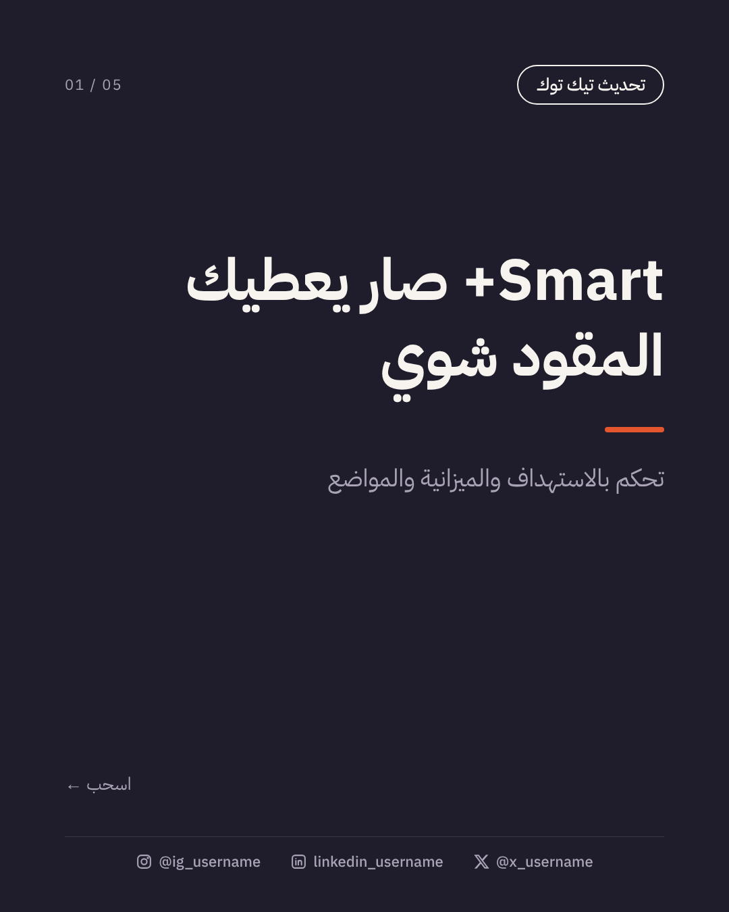

أكثر شكوى كنت أسمعها عن Smart+ في تيك توك: "ما أعرف وش قاعد يصير داخل الحملة!" 😅

تيك توك سمعت الشكوى على ما يبدو. صار فيه تحكم لكل جزء لحاله، فتقدر تخلّي الذكاء الاصطناعي يشتغل على الاستهداف مثلًا، وأنت تمسك المواضع.

بالنسبة لي هذا أحسن حل وسط: أتمتة وين تفيد، وتحكم وين تحتاجه.

وللتذكير: تيك توك حاليًا من أقوى المنصات في السعودية للمنتجات اللي تحتاج "تجربة" قدام الكاميرا.

#تيك_توك #اعلانات_تيك_توك #TikTokAds #تسويق_رقمي #متاجر #السعودية

### لينكدإن
واحد من التحديثات اللي أعتبرها خطوة ذكية من تيك توك هذه السنة: التحكم بأجزاء الأتمتة في حملات Smart+.

بدل خيار "كل شي آلي أو كل شي يدوي"، صار تقدر تحدد وين تبي الأتمتة: الاستهداف، الميزانية، أو المواضع.

ليش هذا مهم؟
لأن أغلب المعلنين ما كانوا ضد الأتمتة.. كانوا ضد الغموض.

الطريقة اللي أنصح فيها:
• ابدأ بأتمتة الاستهداف والميزانية
• احتفظ بالتحكم في الجزء اللي عندك فيه معرفة واضحة عن جمهورك
• شغّل نسخة مقارنة لأسبوعين قبل ما تعمم

المستقبل في الإعلانات واضح: أتمتة أكثر. والميزة التنافسية بتكون لمن يعرف متى يتدخل.

#TikTokAds #التسويق_الرقمي #الأتمتة

### X
تيك توك صارت تسمح في Smart+ تشغّل الأتمتة لكل جزء لحاله: استهداف، ميزانية، مواضع.

أخيرًا 🙌 المعلنين ما كانوا ضد الذكاء الاصطناعي، كانوا ضد إنهم ما يعرفون وش يصير داخل الحملة.

## اليوم 9 — البكسل لحاله ما يكفي: Conversions API
**2026-10-20 · مشكلة**

### انستجرام
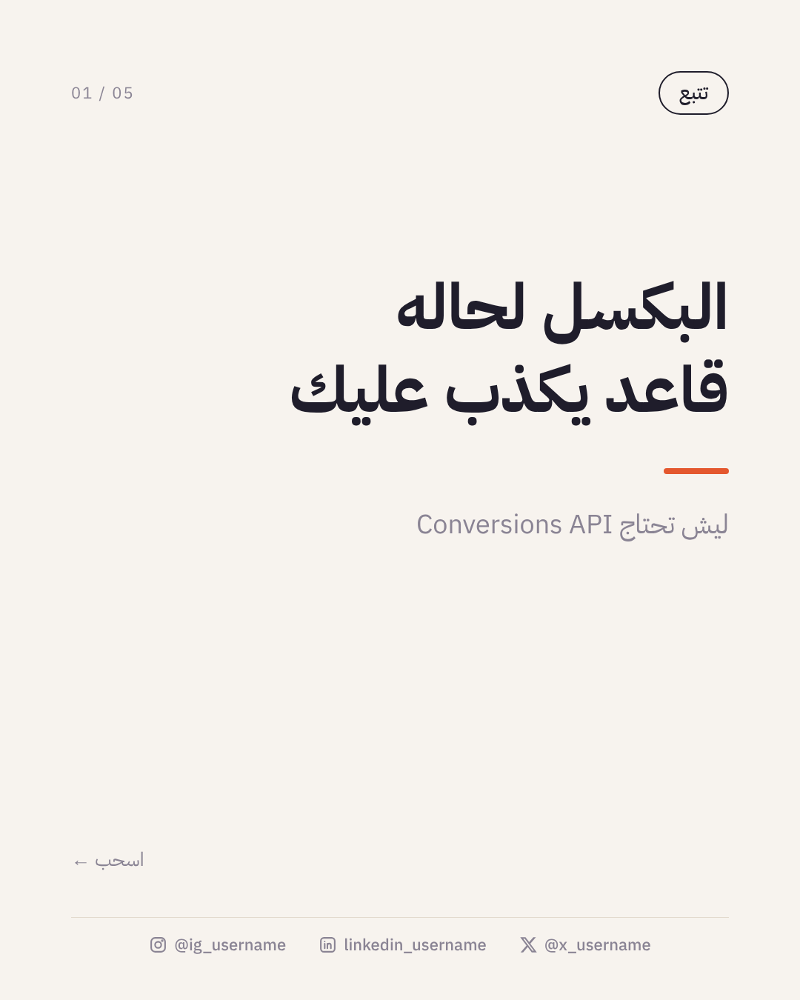

سألت عميلة مرة: "كم طلب جاك من الإعلان أمس؟" قالت ٢٣. مدير الإعلانات كان مسجّل ١٤ 🤔

الفرق هذا مو غريب. البكسل يعتمد على المتصفح، والمتصفحات صارت تحجب أشياء كثيرة.

والمشكلة إن الخوارزمية تتعلّم من البيانات اللي توصلها. بيانات ناقصة = قرارات أضعف.

لو متجرك على سلة أو زد أو شوبيفاي، غالبًا فيه ربط جاهز لـ Conversions API في ميتا وتيك توك وسناب. خذ ١٠ دقايق وتأكد إنه مفعّل.

#ميتا_ادز #بكسل #سلة #زد #متاجر_الكترونية #تسويق_رقمي

### لينكدإن
كل الكلام عن الأتمتة والذكاء الاصطناعي في الإعلانات يرجع لسؤال واحد: وش البيانات اللي تغذّي النظام؟

البكسل وحده صار يفوّت نسبة من التحويلات بسبب إعدادات الخصوصية وحظر الكوكيز.
وهذا يأثر على شيئين:
١. تقاريرك تبيّن أداء أقل من الواقع
٢. خوارزمية التحسين تتعلّم من عينة ناقصة

الحل الأساسي اللي أعتبره اليوم شرط مو إضافة: ربط Conversions API (أو ما يعادله في تيك توك وسناب) مع إزالة التكرار بشكل صحيح.

وفي السعودية أغلب منصات المتاجر (سلة، زد، شوبيفاي) توفر ربط جاهز، فالعذر صار أقل.

آخر مرة راجعت فيها جودة التتبع في حسابكم كانت متى؟

#MarTech #التجارة_الإلكترونية #MetaAds

### X
**1/3** لو أرقام متجرك أعلى من اللي يسجّله مدير الإعلانات.. البكسل قاعد يفوّت مبيعات 🧵

**2/3** المشكلة مو بس تقرير ناقص. الخوارزمية تتعلّم من البيانات اللي توصلها، فتحسب إعلانات ناجحة إنها فاشلة وتوقفها.

**3/3** الحل: Conversions API. وإذا متجرك على سلة أو زد أو شوبيفاي غالبًا الربط جاهز، بس يبي تفعيل وتأكد من إزالة التكرار.
١٠ دقايق ممكن تغيّر شهر كامل.

## اليوم 10 — نظام حماية البيانات الشخصية (PDPL) والتسويق
**2026-10-21 · مشكلة**

### انستجرام
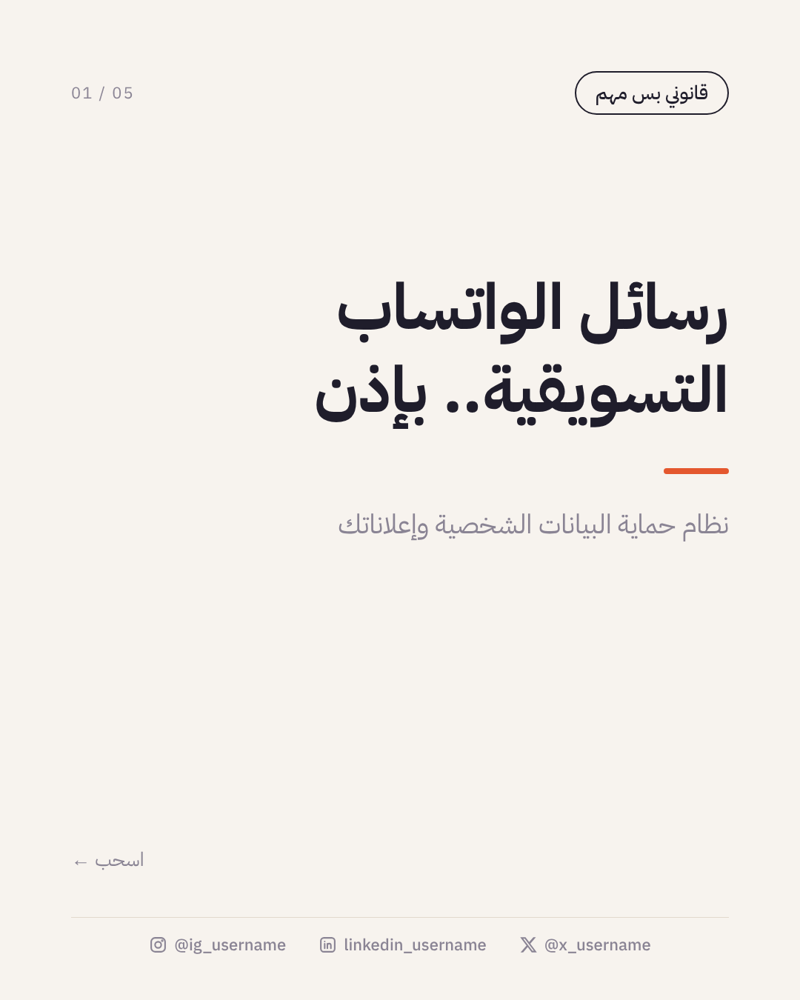

موضوع ما أحد يحب يتكلم فيه، بس لازم 😅

نظام حماية البيانات الشخصية صار مطبّق في السعودية، والتسويق المباشر (رسائل، إيميلات، واتساب) يحتاج موافقة مسبقة من الشخص، ولازم يقدر يلغي بسهولة.

وهذا يأثر على شغلنا كمعلنين بشكل مباشر: نماذج العملاء المحتملين، قوائم إعادة الاستهداف، رسائل الحملات.

الخبر الحلو: الشغل الصح هنا يرفع جودة قائمتك. ناس وافقوا بنفسهم = ناس مهتمين فعلًا.

وللتفاصيل القانونية الدقيقة ارجع لمختص أو لموقع سدايا الرسمي.

#حماية_البيانات #تسويق_رقمي #واتساب_بزنس #ريادة_اعمال #السعودية #اعلانات_ممولة

### لينكدإن
مع تطبيق نظام حماية البيانات الشخصية في السعودية، صار التسويق المباشر يتطلب موافقة مسبقة من الشخص، مع آلية سهلة لسحب الموافقة في أي وقت.

كمختصة حملات، هذا يغيّر أشياء عملية في شغلنا:
• نماذج الـ Lead Gen لازم توضح الغرض وتطلب الموافقة بشكل صريح
• قوائم الأرقام المشتراة أو المجمّعة بدون موافقة خطر حقيقي
• رسائل المتابعة لازم يكون فيها خيار إلغاء واضح

وأشوف فيها فرصة أكثر من قيد: القائمة اللي وافقت بنفسها أصغر.. بس جودتها أعلى بكثير.

تنبيه: هذا رأي تسويقي مو استشارة قانونية. للتفاصيل ارجعوا لمستشار قانوني أو للجهة الرسمية (سدايا).

#PDPL #حماية_البيانات #التسويق_الرقمي

### X
تذكير لكل اللي يرسلون رسائل واتساب وإيميل تسويقية:
نظام حماية البيانات الشخصية في السعودية يشترط موافقة مسبقة + طريقة سهلة للإلغاء.

قوائم الأرقام المشتراة؟ لا تقربها. (مو استشارة قانونية، بس تنبيه مهم)

## اليوم 11 — صفحة الهبوط: الإعلان يجيب الزيارة، الصفحة تبيع
**2026-10-22 · نصيحة**

### انستجرام
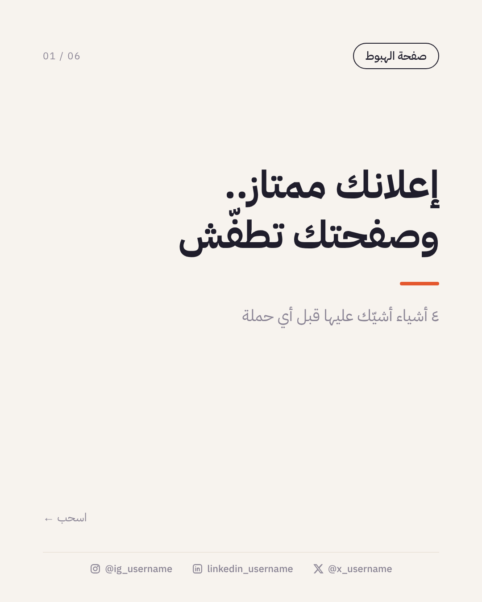

كثير يجيني يقول: "الإعلان عليه ضغطات كثير بس ما فيه مبيعات".

أول شي أسويه؟ أفتح الصفحة من جوالي على نت الجوال، مو على واي فاي المكتب 😄

وغالبًا ألقى وحدة من الأربع: صفحة بطيئة، عرض مختلف عن الإعلان، زر الشراء ضايع، أو ما فيه شي يطمّن العميل.

الإعلان شغلته يجيب الشخص للباب. الصفحة هي اللي تدخّله.

#صفحة_هبوط #تحسين_التحويل #متاجر_الكترونية #اعلانات_ممولة #سلة #السعودية

### لينكدإن
قبل ما أرفع ميزانية أي حملة، أسوي فحص بسيط: أفتح صفحة الهبوط من الجوال على شبكة الجوال، كأني عميل جاي من الإعلان.

وفي أغلب الحالات ألقى سبب واضح لانخفاض التحويل:
• الصفحة بطيئة على الجوال
• العرض في الإعلان مختلف عن أول شاشة في الصفحة
• زر الإجراء مو واضح
• عناصر الثقة ناقصة: طرق الدفع المحلية، مدة الشحن، التقييمات

تحسين نسبة التحويل من ١٪ إلى ٢٪ يساوي عمليًا تقليل تكلفة الطلب للنص، بدون ما تلمس الإعلان.

أحيانًا أفضل استثمار في الحملة.. ما يكون في الحملة نفسها.

#CRO #التجارة_الإلكترونية #التسويق_بالأداء

### X
قبل ما ترفع ميزانية الإعلان، افتح صفحتك من الجوال على نت الجوال.

بطيئة؟ العرض مو نفس الإعلان؟ زر الشراء ضايع؟

تحسين التحويل من ١٪ لـ٢٪ = تكلفة الطلب تنزل للنص. بدون ريال إعلان زيادة.

## اليوم 12 — الوايت فرايدي: ابدأ تحضيرك الحين
**2026-10-23 · نصيحة**

### انستجرام
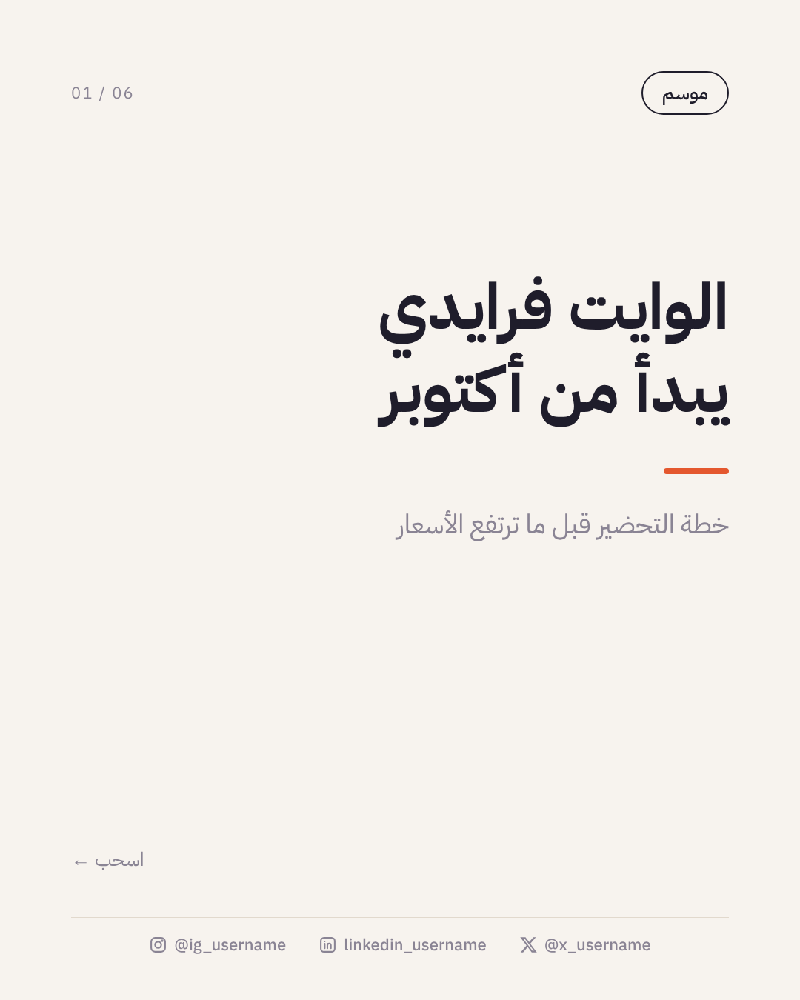

كل سنة نفس القصة: المتاجر تتذكر الوايت فرايدي قبله بأسبوع، والإعلانات تكون غالية والمنافسة نار 🔥

اللي يفوز في الموسم عادةً هو اللي جهّز من بدري: عنده جمهور يعرفه، قائمة عملاء، وإعلانات جاهزة.

أكتوبر هو الوقت المثالي تبني الأساس. وأول نوفمبر تبدأ التشويق.

أنزل لكم قريب قائمة تحضير كاملة بإذن الله.

#الوايت_فرايدي #الجمعة_البيضاء #عروض #متاجر_الكترونية #اعلانات_ممولة #السعودية

### لينكدإن
أغلب الميزانيات في الوايت فرايدي تُصرف في أغلى وقت ممكن: أسبوع الموسم نفسه.

وهذا طبيعي إلى حد ما، بس الفرق بين الحملات اللي تنجح واللي تحترق غالبًا يتحدد قبل بأسابيع.

الإطار اللي أشتغل عليه مع العملاء:
١. أكتوبر: بناء جمهور دافئ بمحتوى وإعلانات بتكلفة أقل
٢. أول نوفمبر: حملات تشويق وقوائم انتظار
٣. الموسم: التركيز على الجمهور الدافئ مع تجديد الإعلانات باستمرار
٤. بعد الموسم: متابعة العملاء الجدد قبل ما ينسونك

السؤال اللي أسأله لكل عميل الحين: كم شخص يعرفك اليوم ويستنى عرضك؟

#WhiteFriday #التجارة_الإلكترونية #التسويق_الرقمي

### X
اللي يبدأ يعلن للوايت فرايدي في أسبوع الموسم بس، يدفع أغلى CPM بالسنة لجمهور ما يعرفه 😬

ابنِ جمهورك الحين، وخلّ إعلانات الموسم تروح لناس تعرفك.

## اليوم 13 — مرحلة التعلّم: لا تلمس الحملة كل يوم
**2026-10-24 · مشكلة**

### انستجرام
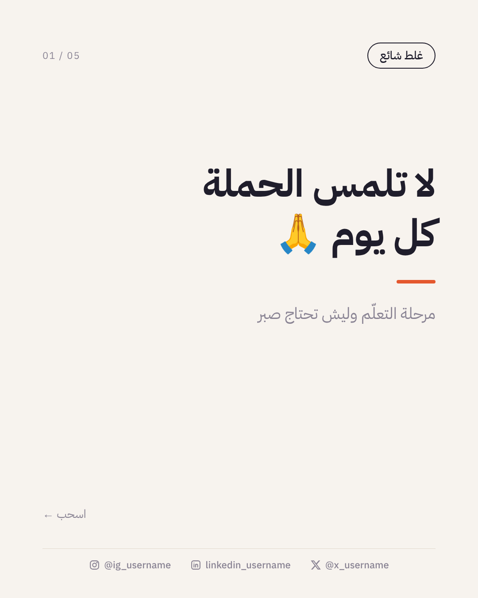

أعرف الإحساس: الحملة اليوم الأول جابت طلبين، ثاني يوم ولا شي.. وتبي تغير كل شي 😅

بس كل تعديل كبير ممكن يرجّع الحملة لمرحلة التعلّم من جديد. وكأنك كل يوم تبدأ من الصفر.

أنا عندي قاعدة مع نفسي: ما أحكم على حملة جديدة قبل ما تجمع بيانات كافية، إلا لو فيه خلل واضح (رابط خربان، إعلان مرفوض، صرف بدون أي نتيجة لفترة طويلة).

الصبر هنا فلوس، حرفيًا.

#ميتا_ادز #اعلانات_ممولة #تسويق_رقمي #نصائح_تسويقية #رواد_الاعمال #السعودية

### لينكدإن
أحد أكثر الأشياء اللي تضر الحملات في أيامها الأولى: التعديل المستمر.

أنظمة الإعلانات (ميتا، تيك توك، قوقل) تحتاج فترة تتعلم فيها مين يتجاوب. وأي تغيير جوهري، زي قفزة كبيرة في الميزانية أو تعديل الاستهداف، ممكن يعيد هالمرحلة.

اللي أطبقه:
• أحدد مسبقًا متى بحكم على الحملة، وبأي رقم
• أفرّق بين خلل تقني (يتصلّح فورًا) وتذبذب طبيعي (ينتظر)
• أزيد الميزانية تدريجيًا، مو بقفزات

الإدارة الجيدة للحملة ما تُقاس بعدد التعديلات. أحيانًا أفضل قرار في اليوم: ما أسوي شي.

#التسويق_بالأداء #MetaAds #إدارة_الحملات

### X
الحملة اليوم الأول جابت طلبين، ثاني يوم صفر، فتغيّر الميزانية والجمهور والإعلانات..

مبروك، رجّعتها لمرحلة التعلّم 🙃

حدد من البداية متى بتحكم وبأي رقم، والتزم.

## اليوم 14 — الريتارقتنق بدون إزعاج
**2026-10-25 · نصيحة**

### انستجرام
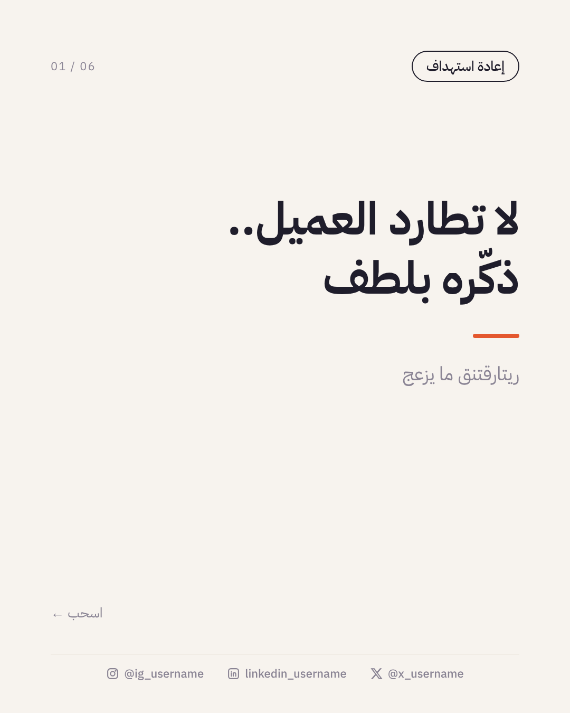

مرة شفت إعلان كنب ٣٠ مرة بعد ما اشتريت الكنب نفسه 😂

هذا ريتارقتنق غلط: ما استثنى اللي اشترى، وما غيّر الرسالة، وما وقف.

الريتارقتنق الصح يحس العميل إنك فاهمه: اللي حط المنتج بالسلة يمكن متردد بسبب الشحن، فقل له عن الشحن. اللي بس شاف الصفحة يمكن يبي يشوف تقييمات.

رسالة مختلفة لكل مرحلة، ومدة محددة، واستثناء اللي اشتروا. بس كذا.

#ريتارقتنق #اعادة_الاستهداف #ميتا_ادز #متاجر_الكترونية #تسويق_رقمي #السعودية

### لينكدإن
إعادة الاستهداف من أعلى الحملات عائدًا عادةً، ومن أكثرها إساءة لصورة البراند لو انعملت غلط.

الأخطاء اللي أشوفها كثير:
• عدم استثناء العملاء اللي اشتروا
• نفس الإعلان يتكرر لأسابيع
• التعامل مع كل الزوار بنفس الطريقة

البديل اللي أطبقه:
١. تقسيم حسب النية: زيارة منتج، إضافة للسلة، بدء الدفع
٢. رسالة مختلفة لكل مرحلة تعالج سبب التردد المحتمل
٣. مدة واضحة لكل شريحة، ومراقبة التكرار (Frequency)

الهدف إن العميل يحس إن البراند فاهمه، مو إنه ملاحَق.

#Retargeting #التسويق_الرقمي #تجربة_العميل

### X
اشتريت كنب، وبعدها شفت إعلانه ٣٠ مرة 🛋️😂

استثنِ اللي اشتروا من الريتارقتنق. وغيّر الرسالة حسب المرحلة. وحط مدة.
٣ إعدادات تفرق بين "تذكير لطيف" و"ليش هالبراند يلاحقني؟"

## اليوم 15 — إرهاق الإعلان: متى تغيّر الكرييتف
**2026-10-26 · مشكلة**

### انستجرام
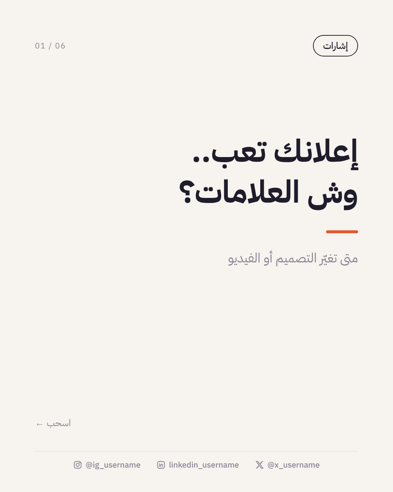

الإعلان مثل الأغنية الحلوة.. تسمعها ١٠٠ مرة وتملّ منها 🎧

حتى أنجح إعلان عندك له عمر. والفكرة إنك تجهّز البديل قبل ما يتعب، مو بعد ما تنهار النتائج.

وأهم شي: الإعلان الجديد لازم يكون جديد فعلًا. نفس الفيديو بخط ثاني ما يحسب. فكّر بزاوية ثانية: ليش يشتري الناس منك؟ وش سبب ما تكلمت عنه للحين؟

#كرييتف #اعلانات_ممولة #ميتا_ادز #تيك_توك #تسويق_رقمي #السعودية

### لينكدإن
في زمن صار فيه الإعلان نفسه هو أهم إشارة للاستهداف، إرهاق الإعلانات صار أسرع وأكثر تكلفة.

المؤشرات اللي أراقبها:
• ارتفاع التكرار مع ثبات الوصول
• انخفاض متواصل في نسبة الضغط
• ارتفاع تكلفة النتيجة بدون تغيّر في المنافسة أو الموسم
• تعليقات سلبية عن كثرة الظهور

والأهم من الرصد: وجود نظام لإنتاج الإعلانات. عندي قاعدة بسيطة مع العملاء: كل أسبوعين لازم يدخل الحساب زوايا جديدة، حتى لو الأداء ممتاز.

لأن الإعلان الناجح اليوم هو اللي بيوقف عن النجاح بعد شهر.

كيف تنظمون إنتاج الإعلانات عندكم؟

#Creative #التسويق_بالأداء #MetaAds

### X
إعلانك الناجح بيتعب. مو احتمال، أكيد.

العلامات: التكرار يطلع، الضغطات تنزل، والتعليقات تقول "شفته ألف مرة".

والحل مو تغيير اللون. غيّر الزاوية كلها.

## اليوم 16 — تغييرات الإسناد والتقارير: لا تقارن أرقام قديمة بجديدة
**2026-10-27 · تحديث**

### انستجرام
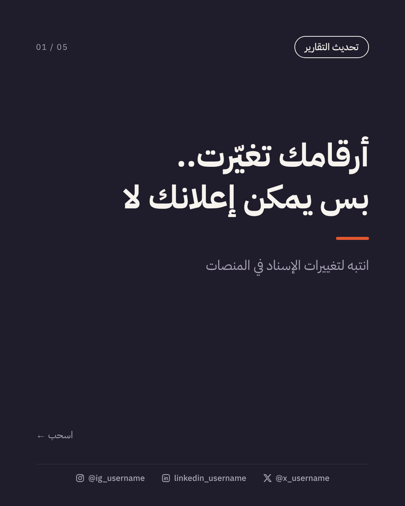

مرة عميل اتصل فيني مفزوع: "النتائج نزلت فجأة!"
فتحنا المتجر.. المبيعات نفسها تقريبًا 🙂

اللي تغيّر كان طريقة حساب المنصة، مو الأداء.

المنصات الإعلانية تحدّث طريقة الإسناد والتقارير بشكل مستمر، وأحيانًا تفصل الضغطات عن التفاعلات الثانية. فلو تقارن بدون ما تنتبه، بتاخذ قرارات غلط.

قاعدتي: رقم المنصة مؤشر. رقم المتجر والبنك هو الحقيقة.

#ميتا_ادز #تحليل_البيانات #تقارير #تسويق_رقمي #متاجر_الكترونية #السعودية

### لينكدإن
تغييرات الإسناد وطريقة احتساب النتائج في المنصات الإعلانية صارت متكررة، وآخرها في ميتا مع الفصل الأوضح بين ضغطات الرابط والتفاعلات الأخرى في التقارير.

المشكلة مو في التغيير نفسه، المشكلة في المقارنات اللي تصير بعده:
شهر قبل التغيير مقابل شهر بعده = قرار مبني على اختلاف في الحساب، مو في الأداء.

اللي أنصح فيه:
• ثبّتوا نافذة إسناد واحدة في التقارير الداخلية
• وثّقوا تاريخ أي تغيير من المنصة
• اعتمدوا مؤشر أعمال مستقل، مثل إجمالي الإيراد مقسوم على إجمالي الإنفاق التسويقي (MER)

المنصات تقيس نفسها. نحتاج دائمًا مرجع من خارجها.

#Attribution #التسويق_بالأداء #تحليل_البيانات

### X
قبل ما توقف حملة لأن "النتائج نزلت فجأة"، تأكد:
هل المنصة غيّرت طريقة الإسناد أو التقارير؟

وقارن دائمًا مع أرقام متجرك. رقم المنصة مؤشر، رقم المتجر هو الحقيقة.

## اليوم 17 — صناع المحتوى (UGC) مقابل المشاهير
**2026-10-28 · مثال**

### انستجرام
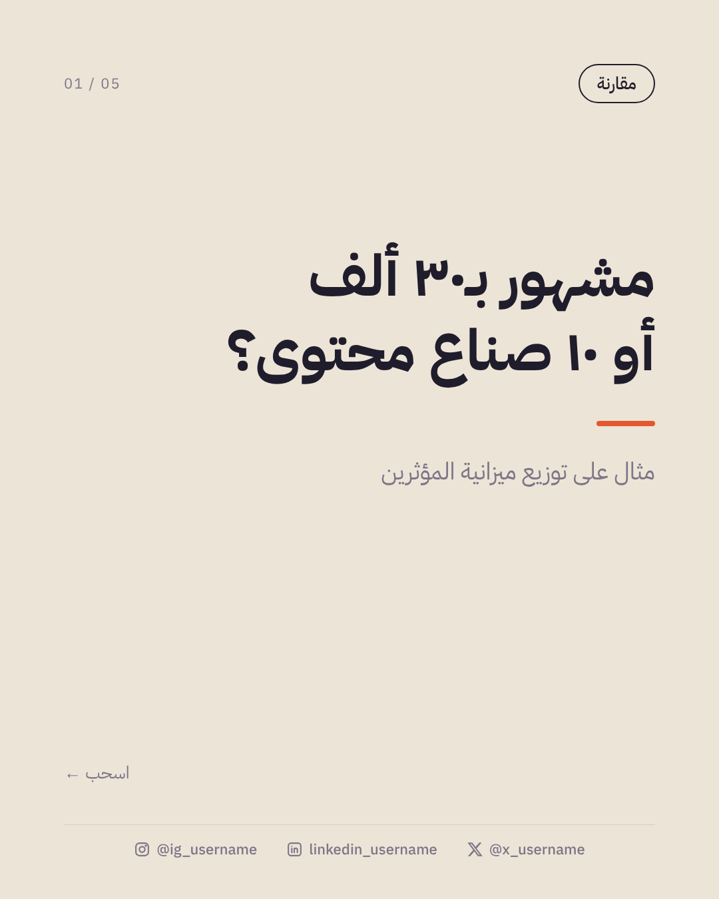

سؤال يجيني كثير: "أعطي المشهور الفلاني ولا لا؟"

جوابي غالبًا: يعتمد.. بس خلني أوريك البديل اللي أحبه 👇

بدل ما الميزانية كلها تروح على ظهور واحد، توزعها على صناع محتوى يسوون فيديوهات طبيعية، وتشغلها أنت كإعلانات. كذا عندك ١٠ زوايا مختلفة بدل وحدة، والفيديو الناجح يعيش معك شهور.

المشاهير لهم مكانهم، خصوصًا للإطلاقات والوعي. بس للمبيعات المستمرة؟ UGC + إعلانات ممولة صعب ينغلب.

(الأرقام بالمثال توضيحية)

#UGC #صناع_المحتوى #مشاهير #اعلانات_ممولة #تسويق_المؤثرين #السعودية

### لينكدإن
سؤال متكرر من أصحاب المشاريع: هل نستثمر في إعلان مع مشهور؟

الجواب يعتمد على الهدف. لكن لو الهدف مبيعات مستمرة، غالبًا أقترح نوزّع جزء كبير من الميزانية على محتوى من صناع محتوى (UGC) ونشغله كإعلانات ممولة.

الأسباب:
• التنوع: عدة زوايا وأشخاص بدل رسالة وحدة، وهذا يخدم خوارزميات الاستهداف الحالية
• القياس: كل فيديو له أرقامه الواضحة
• العمر: الإعلان الناجح يشتغل أسابيع وشهور، مو يوم واحد

المشاهير يظلون أداة قوية للإطلاق وبناء الوعي. الفكرة إننا نختار الأداة حسب الهدف، مو حسب الشهرة.

#UGC #تسويق_المؤثرين #التسويق_الرقمي

### X
نفس الميزانية:
إعلان مع مشهور = ظهور كبير يوم واحد.
١٠ فيديوهات UGC تشغلها كإعلانات = ١٠ زوايا تختبرها، والناجح يشتغل شهور.

للمبيعات المستمرة، أميل للثاني. للإطلاقات، الأول له مكانه.

## اليوم 18 — كواليس: أول أسبوع مع أي حساب إعلاني
**2026-10-29 · شخصي**

### انستجرام
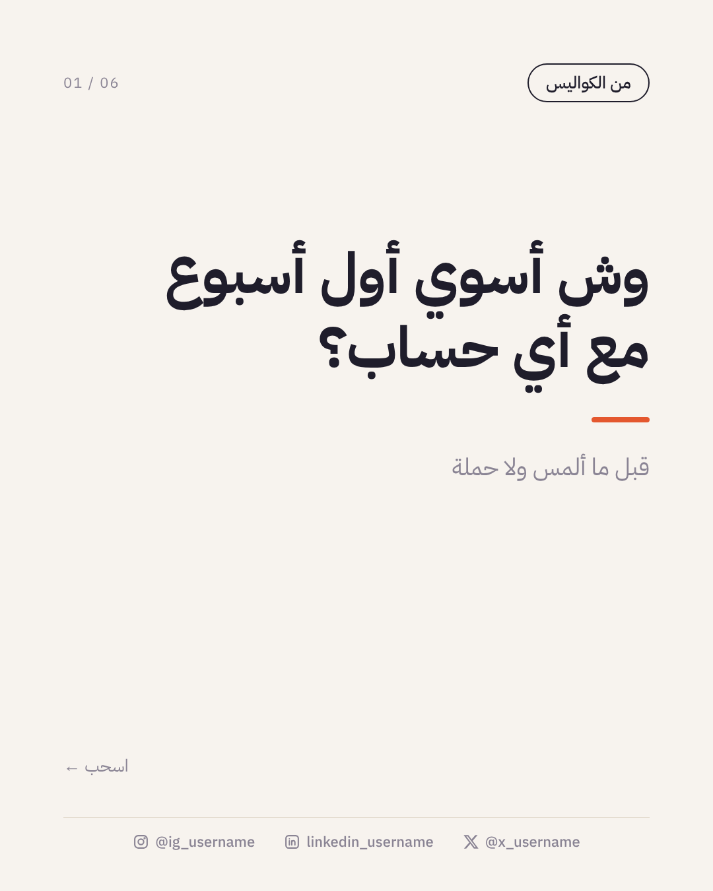

ناس كثير تتوقع إن أول شي أسويه أطلق حملات جديدة 😄

الحقيقة؟ أول أسبوع أغلبه مراجعة وفهم. لأن أسرع طريقة تحرق فيها ميزانية هي إنك تبني على أساس ما تعرفه.

وأكثر شي يفاجئ العملاء: كم مرة نلقى المشكلة في التتبع أو صفحة الهبوط، مو في الإعلان أبدًا.

هذا اللي أشتغل عليه فعلًا، بدون فلاتر 🤍

#ادارة_حملات #اعلانات_ممولة #كواليس #تسويق_رقمي #فريلانسر #السعودية

### لينكدإن
كثير من العملاء يتوقعون إن أول خطوة معي هي إطلاق حملات جديدة.

الواقع إن الأسبوع الأول أغلبه تدقيق:

١. التتبع: هل التحويلات تُسجّل بشكل صحيح ومن غير تكرار؟
٢. اقتصاديات المشروع: هامش الربح، متوسط قيمة الطلب، ورقم التعادل
٣. التاريخ: وش الإعلانات والجماهير اللي نجحت فعلًا، مو حسب الانطباع
٤. تجربة المستخدم: من الإعلان إلى إتمام الشراء على الجوال

وبعدها خطة مكتوبة: ما نوقفه، ما نكبّره، ما نختبره، ومعايير الحكم على كل شي.

الشفافية في هذه المرحلة تبني ثقة أكثر من أي نتيجة سريعة.

#إدارة_الحملات #التسويق_الرقمي #Audit

### X
**1/3** أول أسبوع مع أي حساب إعلاني، تقريبًا ما أطلق ولا حملة جديدة 🧵

**2/3** أراجع التتبع ← أحسب رقم التعادل ← أشوف وش اشتغل فعلًا بالأرقام ← أجرب رحلة الشراء من الجوال.

**3/3** وبعدها خطة مكتوبة: وش نوقف، وش نكبّر، وش نختبر، وبأي رقم نحكم.
أسرع طريقة تحرق فيها ميزانية؟ تبني على أساس ما تعرفه.

## اليوم 19 — خرافات شائعة عن الإعلانات الممولة
**2026-10-30 · مشكلة**

### انستجرام
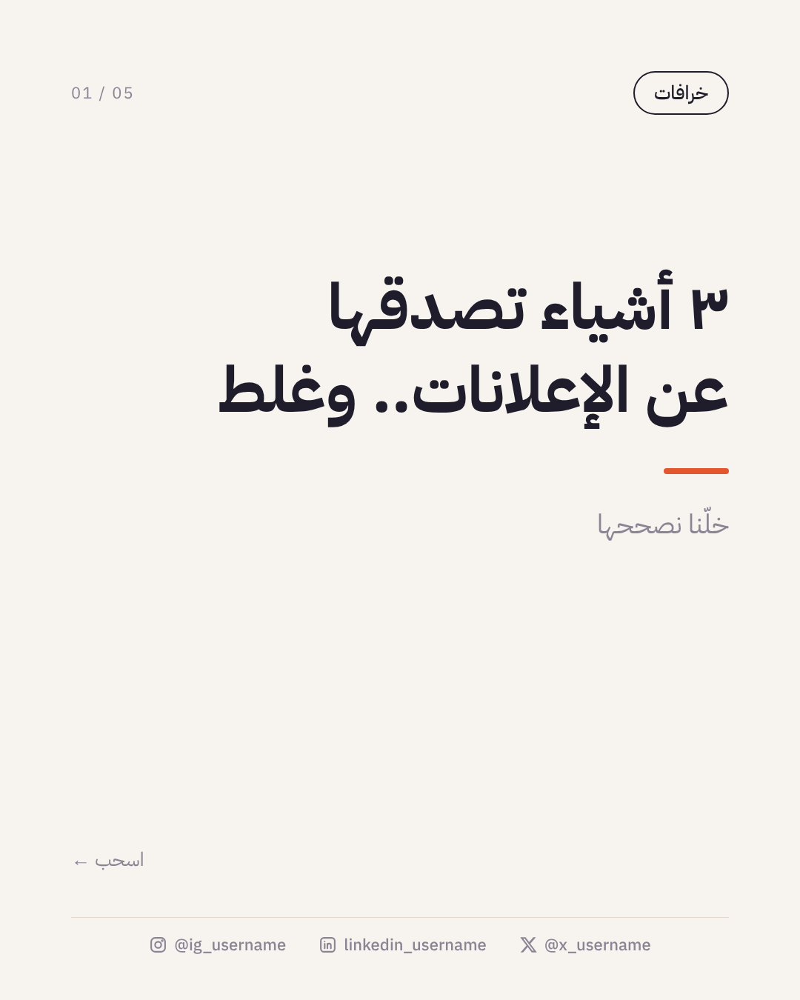

كل أسبوع أسمع وحدة من هذي 😅

وأفهم ليش تنتشر: أحد جرّب مرة وما نجح، فصارت "قاعدة".

بس الإعلانات الممولة مو حظ. هي اختبار وقياس وتعديل. وكثير من اللي نسميه "المنصة ما تنفع" هو في الحقيقة "الإعلان ما كان مناسب للمنصة".

اكتب لي بالتعليقات أغرب خرافة سمعتها عن الإعلانات، وأرد عليها 👇

#اعلانات_ممولة #خرافات_تسويقية #تسويق_رقمي #ميتا_ادز #تيك_توك #السعودية

### لينكدإن
من أكثر الجمل اللي أسمعها في الاجتماعات الأولى: "جربنا تيك توك/سناب/لينكدإن وما نفع معنا".

ولما نرجع للتفاصيل، غالبًا نلقى واحد من هذي:
• نفس الإعلان منقول من منصة ثانية بدون تعديل
• ميزانية ما تكفي للخروج من مرحلة التعلّم
• مدة اختبار قصيرة جدًا
• هدف حملة ما يطابق الهدف التجاري

هذا ما يعني إن كل منصة تناسب كل مشروع. لكن الحكم على منصة لازم يكون بعد اختبار عادل.

وش منصة "ما نفعت" معكم؟ وهل كان الاختبار عادل؟

#التسويق_الرقمي #الإعلانات_الممولة #اختبار

### X
"جربنا تيك توك وما نفع"

طيب الإعلان كان مصنوع لتيك توك؟ ولا نفس إعلان انستقرام؟
الميزانية كفت يتعلم؟ الاختبار كم يوم؟

أغلب "المنصة ما تنفع" = اختبار ما كان عادل.

## اليوم 20 — خلاصة ٢٠ يوم + دعوة للتواصل
**2026-10-31 · دعوة**

### انستجرام
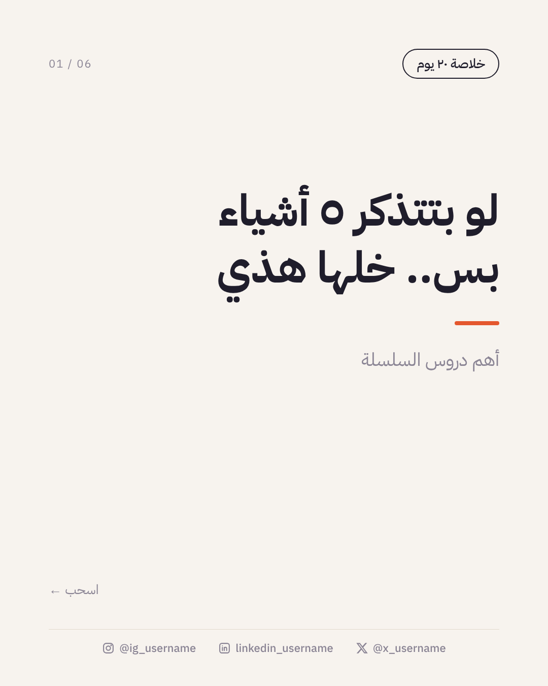

٢٠ يوم خلصت بسرعة! 🤍

شكرًا لكل أحد علّق وسأل وشارك. أسئلتكم صراحة هي اللي وجهت نص المحتوى.

جمعت لكم أهم ٥ دروس بهالبوست، احفظه.

وإذا عندك متجر أو مشروع وتبي أحد يراجع حملاتك قبل الوايت فرايدي، أو تبي نبني خطة إعلانات على ميتا وقوقل وتيك توك وسناب، راسلني بالخاص.

والمحتوى مكمل، بس الجاي بيكون أعمق 👀

#ادارة_حملات #اعلانات_ممولة #تسويق_رقمي #الوايت_فرايدي #متاجر_الكترونية #السعودية

### لينكدإن
خلّصت سلسلة ٢٠ يوم عن إدارة الحملات الإعلانية، وهذه أهم خمس نقاط لو بتحتفظ بشي واحد منها:

١. الإعلان نفسه صار أقوى إشارة استهداف، والتنوع فيه ضرورة
٢. جودة التتبع تحدد جودة قرارات الخوارزمية
٣. رقم التعادل أهم من أي ROAS في التقرير
٤. الصبر في مرحلة التعلّم توفير، مو تأخير
٥. نسبة التحويل في الصفحة ممكن تغيّر اقتصاديات الحملة بالكامل

شكرًا لكل من شارك برأيه وسؤاله. النقاشات هنا أضافت لي كثير.

وإذا كنتم تجهزون لموسم نهاية السنة وتبون مراجعة لحساباتكم الإعلانية، رسالتكم مرحب فيها.

#التسويق_الرقمي #إدارة_الحملات #السعودية

### X
**1/4** خلاصة ٢٠ يوم عن الإعلانات الممولة 🧵

**2/4** ١. الإعلان نفسه صار الاستهداف
٢. بكسل + Conversions API، مو بكسل لحاله
٣. احسب رقم التعادل قبل تحكم

**3/4** ٤. لا تلمس الحملة كل يوم
٥. الإعلان يجيب الزيارة، الصفحة تبيع

**4/4** شكرًا لكل اللي تابع وسأل 🤍
تبي مراجعة لحملاتك قبل الوايت فرايدي؟ الخاص مفتوح.
